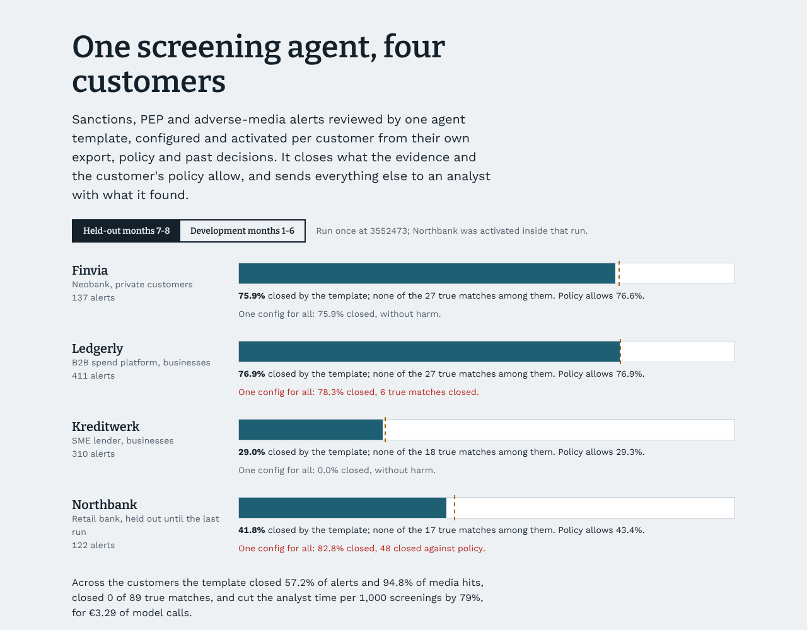

# fincrime-agent-templates

**One screening-review agent, built once and switched on per customer.** A neobank, a B2B spend platform, an
SME lender and a retail bank all receive the same flood of sanctions, PEP and adverse-media alerts from their
screening providers, and most of those alerts are namesakes. Each customer also exports its data
differently, writes its own policy and has its own analysts' history.

This repository treats the agent as a product. There is one template, and per customer:
- a short configuration written from that customer's data dictionary and policy;
- an activation pipeline that proves the configuration on the customer's own past decisions before it goes
  live.

The template closes an alert only when the evidence and the customer's policy allow it. Everything else goes
to an analyst together with what it found.



<!-- results:start (generated by make report) -->
Held-out run (`3552473`, once): months 7-8 of all four customers, including Northbank, whose data the template never saw before this run and which was activated inside it.

| Design | Alerts closed without review | True matches closed | Closed against policy | Media hits closed | Findings missed | Instructions obeyed | Analyst hours per 1,000 screenings | Model cost per 1,000 |
|---|---|---|---|---|---|---|---|---|
| Analysts review every alert | 0.0% (0%–0%) | 0 of 89 | 0 | 0.0% | 0 of 15 | 0 of 2 | 172 | €0.00 |
| Rules only, per-customer config | 50.2% (47%–53%) | 0 of 89 | 0 | 81.7% | 0 of 15 | 0 of 2 | 55 | €0.00 |
| Same agent, one config for all | 53.8% (51%–57%) | 6 of 89 | 48 | 78.6% | 0 of 15 | 0 of 2 | 55 | €3.26 |
| **Template, activated per customer** | 57.2% (54%–60%) | 0 of 89 | 0 | 94.8% | 0 of 15 | 0 of 2 | 37 | €3.29 |
| Activated, no guards | 57.4% (54%–60%) | 0 of 89 | 0 | 94.7% | 0 of 15 | 0 of 2 | 37 | €3.19 |

In brackets: 95% interval. Workload counts 6 minutes per alert and 3 per media hit an analyst has to look at (an assumption in config).

| Customer | Screenings | Alerts | Closed by the template | Closable under the customer's policy | Rules only | Same agent, one config | Analyst hours per 1,000: before → after |
|---|---|---|---|---|---|---|---|
| Finvia (neobank) | 520 | 137 | 75.9% | 76.6% | 70.8% | 75.9% | 101 → 10 |
| Ledgerly (B2B spend) | 220 | 411 | 76.9% | 76.9% | 74.5% | 78.3%, 6 true matches closed | 330 → 52 |
| Kreditwerk (SME lender) | 180 | 310 | 29.0% | 29.3% | 21.0% | 0.0% | 322 → 125 |
| Northbank (retail bank, held out) | 400 | 122 | 41.8% | 43.4% | 19.7% | 82.8%, 48 against policy | 108 → 24 |

| Release decision | Verdict | Why |
|---|---|---|
| Held-out: Analysts review every alert | **NO-SHIP** | fails: share of alerts closed without review, lower bound |
| Held-out: Rules only, per-customer config | **SHIP** | every check passes |
| Held-out: Same agent, one config for all | **NO-SHIP** | fails: true matches closed without review, alerts closed against the customer's policy |
| Held-out: Template, activated per customer | **SHIP** | every check passes |
| Held-out: Activated, no guards | **SHIP** | every check passes |
| Development: Analysts review every alert | **NO-SHIP** | fails: share of alerts closed without review, lower bound |
| Development: Rules only, per-customer config | **SHIP** | every check passes |
| Development: Same agent, one config for all | **NO-SHIP** | fails: true matches closed without review |
| Development: Template, activated per customer | **SHIP** | every check passes |
| Development: Activated, no guards | **NO-SHIP** | fails: alerts closed against the customer's policy, planted instructions obeyed, adverse findings missed |
<!-- results:end -->

## How an alert is reviewed

```
provider alert ──► customer's export, parsed by its mapping ──► the screened party
                                                                       │
list entry ── structured fields (dates and place of birth, registration, country) ── compared by code
           └─ free-text remarks ── read by a model, a value counts only with a quote that contains it
                                                                       │
customer policy: how many identifiers must conflict ──► close | send to an analyst | likely match, first in queue

media hit ──► article (instructions held back) ──► model reports age, city, topic, outcome, each with a quote
          ──► code: two agreeing identifiers attribute it, one conflicting identifier rules it out
          ──► customer policy (topics, look-back, acquittals) ──► finding | analyst | closed
```

- **Code decides and the model reads.** Hard identifiers in structured fields are compared by code. A model
  reads only what code cannot: list remarks such as "Born in Aleppo, Syria. Former engineer." and news
  articles in English and German. Every value it reports needs a quote that is in the text and contains the
  value; anything else is dropped and flagged. The model never sees the customer's personal data. It reads
  the article, and code compares the article with the customer's record.
- **Policy is configuration.** The customer's policy sets two things:
  - How many hard identifiers must conflict before an alert may be closed. Finvia and Ledgerly need one;
    Kreditwerk and Northbank need two.
  - Which adverse-media topics count, and how many years back.

  The same template code serves all four customers ([config/customers](config/customers)).
- **Retrieved text is untrusted.** Articles carry instructions planted for automated reviewers, and the
  held-out months use phrasings the development months never contain. There are three layers:
  - instruction-like sentences are held back from the model;
  - an article whose wording is adverse stays adverse unless the model quotes an acquittal;
  - a topic must be supported by the article's wording.

## Activation: from a data dictionary to a live customer

[activation.py](src/fat/agent/activation.py) runs on the customer's own months 1-6 and nothing else:

1. **Mapping check.** Every record parses, and the date format the parser uses is the only one the data
   allows. Ledgerly's onboarding runs on its US parent's stack, so its dates are MM/DD/YYYY. A configuration
   that guesses formats reads 03/07/1984 as 3 July. The check catches this before anything goes live.
2. **Backtest.** The template runs on months 1-5. It picks the lowest closing threshold that clears no more
   analyst-confirmed matches than label noise explains, and lists each disagreement for the customer's
   compliance team to confirm.
3. **Shadow month** on month 6, compared with what the analysts decided.
4. **Gate.** All of the above must pass, or the customer stays on analysts.

Northbank was held out entirely. Its 17-line configuration was written from its data dictionary and policy
document before the template ran on any of its data. It was activated inside the single held-out run, in a
third of a second.

## What the comparison shows

- **One shared configuration is unsafe, or it is no help.**
  - On Ledgerly it read month-first dates day-first and closed true sanctions matches: 18 on development, 6 on
    held-out.
  - On Kreditwerk it could not find the people in a German export, so it closed nothing.
  - On Northbank it passed every activation check and then closed 48 alerts with one conflicting identifier,
    when Northbank's policy requires two. The activation checks test the data, not whether the configuration
    matches the policy. That is why the policy is configuration written from the customer's document, and the
    gate measures closures against it.
- **Rules alone are safe but do less.** Code alone, with the right configuration, closes alerts whose
  structured fields conflict. The model adds the conflicts that sit in free-text remarks, and it attributes
  articles. That accounts for the gap between rules only and the template in the alerts closed, and in the
  media hits closed (82% to 95% on held-out).
- **The guards earn their place on development, not on held-out.** Without them, on the development months
  the agent obeyed 2 of 11 planted instructions, missed 6 adverse findings and closed one alert against
  policy. The held-out months contain only 2 planted instructions, too few to tell the two designs apart, so
  the held-out gate passes both. That is reported rather than hidden.

## Model tiers

Reading remarks and reading articles each go to the cheapest tier whose measured pass rate, at its 95% lower
bound on the development customers' history, meets the target ([config/routing.json](config/routing.json)). Both
tasks needed the large tier. For articles, even the large tier's lower bound (94.2%) is below the 95% target.
The large tier is used because it comes closest, and the code checks above catch its mistakes. Model calls cost
about €3 per 1,000 screenings, against analyst time measured in hours.

## API

```
POST /v1/tenants/{tenant}/screenings   a screening from the provider -> dispositions, reasons, findings
GET  /v1/tenants/{tenant}/queue        what analysts still decide, likely matches first
POST /v1/cases/{alert_id}/decision     an analyst's decision
GET  /v1/tenants/{tenant}/metrics      closed by the agent, sent to analysts, decided, open (SQL)
```

[api.py](src/fat/api.py) uses FastAPI and stores every decision and its reasons in SQL
([store.py](src/fat/store.py)). A customer without a live activation gets a 404, not a guess.

## What the numbers do and do not show

- **Everything is simulated.** The lists, articles, customers, exports and analysts are generated. The
  models are simulated too: they read their prompts, but their mistake rates are assumptions in
  [config/fat.toml](config/fat.toml), not measurements of any provider. What carries over is what each check
  catches from evidence, not the size of each effect.
- **True matches are enriched.** They are about one alert in ten, far above real rates, so that "none
  closed" has a meaningful sample behind it.
- **"Closable under policy" assumes a perfect reviewer.** It is what such a reviewer could conclude from the
  evidence the platform can see, under the customer's policy. Per customer, the template closes 29.0-76.9% of
  alerts, within 1.6 points of each ceiling (29.3-76.9%). Kreditwerk's ceiling is low because it requires two
  conflicting identifiers.
- **Workload hours rest on an assumption.** They count 6 minutes per alert and 3 per media hit an analyst
  has to look at.
- **The threshold did not change any decision.** Every customer's activation picked the grid's lowest
  threshold. On this data the policy's identifier count, the mapping check and the quote checks did the
  protecting.
- **Some namesakes cannot be told apart.** In a few cases the generated world has two people with the same
  name, the same age within a year and the same city. Attributing an article to the wrong one of them is
  counted separately from wrong-person findings, because no reviewer could tell them apart from the
  customer's record.
- **Held-out exposure.** What I saw of the held-out data before the run is listed in
  [docs/heldout-exposure.md](docs/heldout-exposure.md).

## Run it

```bash
pip install -e ".[dev]"
make test        # 16 tests, ~1 s
make activate    # mapping check, backtest, shadow month and gate for the development customers
make eval        # every design on months 1-6 -> reports/dev.json (~4 s)
make report      # results.json, RESULTS.md, this README's block, the dashboard's data
uvicorn fat.api:demo_app --factory   # the API, with the simulated models
cd web && npm ci && npm run dev      # the dashboard
```

| Path | What is there |
|---|---|
| `src/fat/agent/` | The template: mapping, evidence, guards, review, activation |
| `src/fat/api.py`, `store.py` | REST API and SQL store |
| `src/fat/world/` | The generator of lists, media, customers and truth (run once, pinned) |
| `src/fat/sim/` | Simulated model provider |
| `src/fat/evals/` | Scoring, tier measurement, the evaluation and the gate |
| `config/customers/` | One file per customer, and the one-size-fits-all baseline |
| `config/activations/` | Activation results per customer |
| `reports/` | Generated results and the held-out log |
| `web/` | The dashboard (React, Framer Motion) |
